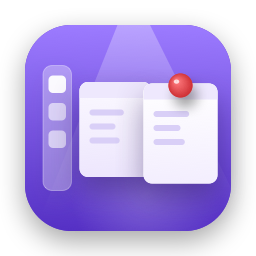
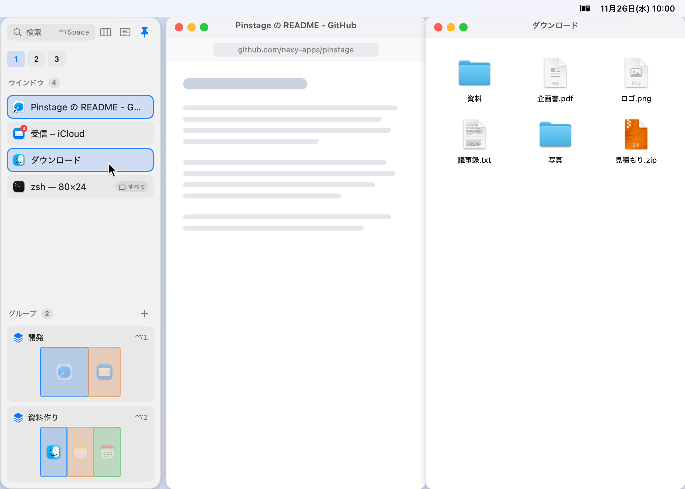
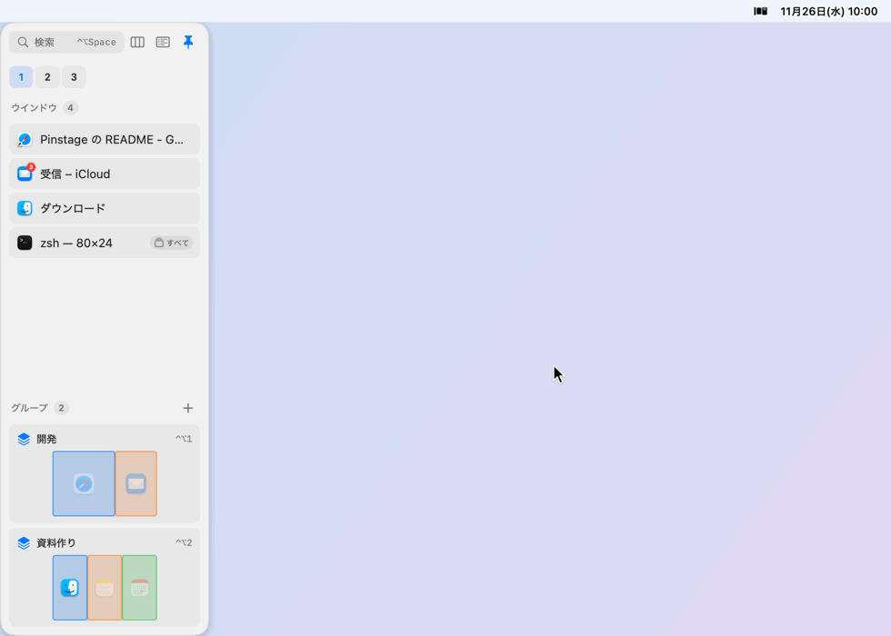
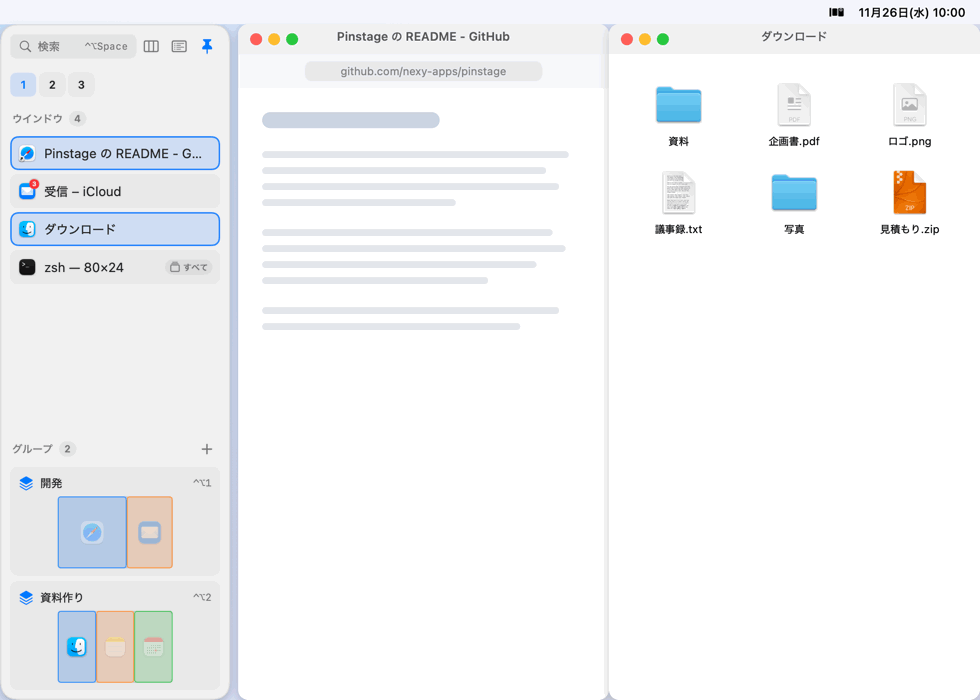

<p align="center">
  
</p>

<h1 align="center">Pinstage</h1>

<p align="center">
  見たいウインドウだけを、グループを作らずにその場で並べて最前面に出せる macOS のメニューバーアプリ
</p>

<p align="center">
  <a href="LICENSE"></a>
  
  
</p>

<p align="center">
  
</p>

> [!NOTE]
> **いまは β 版です**（最新の版は [Releases](https://github.com/nexy-apps/pinstage/releases) を見てください）。思わぬ不具合があるかもしれません。見つけたら [Issues](https://github.com/nexy-apps/pinstage/issues) で教えてください。操作や設定の保存形式は、正式版までに変わることがあります。

> **English:** Pinstage is a macOS menu bar app that lets you pick just the windows you want to see and tile them in front, without first sorting them into groups. A window bar on any edge of the screen lists your windows; click, ⌘-click, or drag them out to bring them to the front and arrange them side by side. Save combinations as groups and recall them later. The UI is currently in Japanese.

## ステージマネージャとの違い

ステージマネージャでは、ウインドウはどれか 1 つのグループに属します。横に並べて比べるには、先にグループにまとめる必要があり、まとめると元のグループから抜けてしまいます。

Pinstage では、ウインドウバーで選んだウインドウが、そのまま**ステージ**に出て並びます。ウインドウはどのグループにも縛られません。比べたいウインドウを選ぶだけで並べられ、保存したグループは変わりません。ステージは、ウインドウを並べる場所で、画面からメニューバー・Dock・ウインドウバーを除いた残りです。

## 使い方

1. **出す**：ウインドウバーの行をクリックすると、そのウインドウだけがステージに出ます。⌘＋クリックすると横に足して、選んだウインドウを並べます（行をウインドウバーの外へドラッグしても足せます）。ステージに出ているウインドウの行には、青い枠が付きます

   <p align="center">
     
   </p>

2. **とっておく**：並べた組み合わせは、グループの見出しの ＋ から「ステージをグループとして保存」すると、並べ方と一緒に保存できます。ウインドウバーのグループの行を押すか、⌃⌥1〜9 で呼び出せます

   <p align="center">
     
   </p>

3. **切り替える**：⌥Tab で、ウインドウスイッチャーが開きます。デスクトップごとにウインドウが並び、選ぶまではデスクトップを切り替えません。スペースで複数を選んで ↩ を押すと、選んだウインドウをステージに並べます

   <p align="center">
     
   </p>

## できること

- **ウインドウバー**：画面の端（左・右・上・下）に、いまのデスクトップのウインドウとグループを並べます。見た目はアイコンの並び・一覧・サムネイルから選べ、「常に出す」か「自動で隠す」にできます
- **その場で並べる**：クリックでそのウインドウだけを出し、⌘＋クリックかウインドウバーの外へのドラッグで横に足します。ダブルクリックでステージいっぱいに広げます
- **並べ方**：自動・左右・上下・4 分割・6 分割・左を大きく、から選べます。編集画面で、自分の型も作れます
- **グループ**：組み合わせを並べ方と一緒に保存し、ウインドウバーや ⌃⌥1〜9 で呼び出せます。自分で整えた画面を、位置・大きさごと記録することもできます
- **ウインドウスイッチャー**：⌥Tab で、デスクトップごとにウインドウを並べた切り替え画面を開きます。複数を選んで、まとめてステージに並べることもできます
- **検索**：⌃⌥Space で、ウインドウ名・アプリ名・グループ名から探せます
- **デスクトップ・ディスプレイごと**：ウインドウバーとステージは、デスクトップ・ディスプレイごとに分かれます。行を別のディスプレイのウインドウバーへドラッグすると、そのディスプレイへ移せます
- **アプリのバッジ**：未読数などの Dock のバッジを、ウインドウバーとウインドウスイッチャーにも出します。アプリ独自のバッジも出せます（[docs/BADGES.md](docs/BADGES.md)）
- **ショートカットと自動化**：ショートカットは設定で割り当て直せます。macOS の「ショートカット」アプリや、`pinstage://` の URL からも操作できます
- **再起動しても残す**：グループ・型・ウインドウの並び順を覚えておきます。ログイン時に起動もできます
- **アップデート**：新しい版を 1 時間に 1 回確かめ、メニューバーのアイコンの印とメニューで知らせます（画面には割り込みません）。メニューから、そのまま更新でき、許可も取り直さずに済みます

くわしい操作は [docs/USAGE.md](docs/USAGE.md)、くわしい構成は [docs/ARCHITECTURE.md](docs/ARCHITECTURE.md)、手で確かめる項目は [docs/TESTING.md](docs/TESTING.md) を見てください。

## ダウンロード

[Releases](https://github.com/nexy-apps/pinstage/releases) から `Pinstage-<版>.dmg` をダウンロードして開き、`Pinstage` を `Applications`（アプリケーションフォルダ）へドラッグしてください（`.zip` もあります。展開して `Pinstage.app` を入れる形で、中身は同じです）。macOS 26 以降で、Intel と Apple Silicon のどちらの Mac でも動きます。

**本物の Pinstage は、この [Releases](https://github.com/nexy-apps/pinstage/releases) からだけ配っています。** ほかの場所で配られているものは、作者が作ったものではありません。

作者が自分で作った証明書（nexy Release Signing）で署名していますが、Apple の公証は受けていないので、初めて開くときに macOS に止められます。「"Pinstage.app"は開いていません」「Apple は、"Pinstage.app"に Mac に損害を与えたり、プライバシーを侵害する可能性のあるマルウェアが含まれていないことを検証できませんでした。」と出て、「ゴミ箱に入れる」と「完了」のボタンが並びます。

次のどちらかで開けます。一度開けば、次からは止められません。

**システム設定から（おすすめ）**

1. 「完了」を押す（「ゴミ箱に入れる」は押さない。押すと、アプリがゴミ箱に移ります）
2. システム設定 →「プライバシーとセキュリティ」を開き、下のほうへスクロールする
3. 「"Pinstage.app"は開いていません…」の横の「このまま開く」を押す
4. パスワードか Touch ID で確かめたら、もう一度 Pinstage を開く

**ターミナルから**

1. 「完了」を押す
2. ターミナルで次を流す

   ```bash
   xattr -dr com.apple.quarantine /Applications/Pinstage.app
   ```

3. Pinstage を開く

開くと「アクセシビリティ」の許可を求められます。システム設定で Pinstage をオンにしてください（ほかのアプリのウインドウを動かす・前に出すために使います）。形式を「サムネイル」にしたときだけ、「画面収録」の許可も求められます。

入れたあとは、アプリの中から新しい版に更新できます（メニューバーのアイコン →「アップデートを確認…」。自動でも確かめます）。更新のときは、「このまま開く」も、許可の取り直しも要りません。

2026-11 に、アプリの ID と署名を変えて、版を 0.1.0 から出し直しました。それより前の β 版（ID `app.pinstage.Pinstage`）からは更新できないので、使っていた場合は、ここから入れ直し、アクセシビリティ（と画面収録）の許可も取り直してください（一覧の古い Pinstage を「−」で消してから、もう一度許可します）。グループと型は、そのまま引き継がれます。

メニューバーに Pinstage のアイコンが出て（Dock には出ません）、画面の左端にウインドウバーが出ます。macOS のステージマネージャはオフにしてください（オンだと、並べたとおりになりません）。

## ソースからビルド

### 用意するもの

- macOS 26 以降
- Xcode 26 以降
- [XcodeGen](https://github.com/yonaskolb/XcodeGen)（`brew install xcodegen`）

### 手順

```bash
git clone https://github.com/nexy-apps/pinstage.git
cd pinstage
make cert   # 開発用の署名の証明書を作る（最初に 1 回だけ。Mac のログインパスワードを聞かれる）
make setup  # push の前に自動テストを流す git hooks を有効にする（最初に 1 回だけ）
make run    # ビルドして /Applications/Pinstage Dev.app に置き、起動する
```

自分でビルドしたものは「Pinstage Dev」という名前の開発のビルドです（ID は `app.nexy.Pinstage.dev`、URL スキームは `pinstage-dev://`）。`make run`・`make install` のどちらも、`/Applications/Pinstage Dev.app` に置きます（開発版のアプリはいつも 1 つで、システム設定の許可の一覧にも「Pinstage Dev.app」と出るので、配る版の「Pinstage.app」と見分けられます）。配る版の Pinstage とは別のアプリとして扱われ、更新の確認はしません。グループと型（`library.json`）は、配る版と同じファイルを使います。

初めて起動すると、アクセシビリティの許可を求められます。ほかのアプリのウインドウを動かすために使います。システム設定 →「プライバシーとセキュリティ」→「アクセシビリティ」で Pinstage Dev をオンにしてください。

形式を「サムネイル」にしたとき（ウインドウバーの見出しのボタンか、メニューバー → 設定… →「形式」）は、画面収録の許可も求められます。許可したあと、Pinstage Dev を開き直してください。

### 署名について

macOS は、アプリが同じものかを「アプリの ID ＋ 署名の証明書」で見分けます。証明書なし（アドホック署名）では、ビルドし直すたびに別のアプリと見なされ、アクセシビリティと画面収録の許可を取り直すことになります。そこで、開発のビルド（`make run`・`make install`・`make update-test`）は、`make cert` で作る開発用の証明書（`nexy Dev Signing`。作者以外は `DEV_CERT="〇〇 Dev Signing"` で自分の名前にできる）で署名します。初めてビルドするときに、codesign が鍵を使ってよいかを聞かれたら「常に許可」を押します。証明書がないと止まって `make cert` を案内します。証明書なしでビルドしたいときだけ、`ADHOC=1` を付けます（例：`make run ADHOC=1`）。

配る版は、作者だけが持つ別の証明書（`nexy Release Signing`）で署名します。この証明書と、更新ファイルの署名の鍵は、ふだんは閉まっている鍵付きのキーチェーン（金庫）に入っていて、`make dist`・`make publish` のときだけ、その場でパスワードを聞いて開けます。

初めてビルドするときに、更新の仕組み（[Sparkle](https://sparkle-project.org)）の配布物を GitHub から取り寄せて、`Vendor/Sparkle` に置きます（ネットワークが要ります。取り寄せたファイルは、決めてある SHA-256 と合うことを確かめてから使います）。

| コマンド | すること |
|---|---|
| `make cert` | 開発用の証明書（`nexy Dev Signing`）を作る（最初に一度だけ。作者以外は `DEV_CERT="〇〇 Dev Signing"` で自分の名前にできる） |
| `make setup` | push の前に自動テストを流す git hooks を有効にする（最初に一度だけ） |
| `make run` | 開発用（Debug。速くビルドできる）にビルドし、動いている Pinstage Dev を終了して、`/Applications/Pinstage Dev.app` に置き換えて起動する（コードを直しては試すときに） |
| `make test` | PinstageCore のテストを動かす |
| `make install` | 配る版と同じ設定でビルドし、`make run` と同じ `/Applications/Pinstage Dev.app` に入れる（起動はしない。配る版に近い形で動きを確かめるときに。配る版の Pinstage とは別のアプリとして並ぶ） |
| `make uninstall` | `/Applications/Pinstage Dev.app` を削除する（`make run`・`make install` のどちらで入れたものも。グループと設定は残る） |
| `make dist` | Releases に置く DMG と zip（`dist/Pinstage-<版>.dmg`・`.zip`・`.sha256`）を作る（作者だけ。金庫を開けて、配る版用の証明書で署名する。パスワードを聞かれる） |
| `make publish` | DMG と zip を作り、GitHub に Release（タグ `v<版>`）を作ってアップロードする（作者だけ）。β 版は `make publish BETA=1`（タグ `v<版>-beta.1`・プレリリース）。zip に金庫の中の鍵で署名し、版の一覧（`appcast.xml`）を作って、版の一覧の置き場所（[nexy-apps.github.io](https://github.com/nexy-apps/nexy-apps.github.io)）に送る（コミット済みで、GitHub の main と同じ状態からだけ動く） |
| `make update-test` | 更新を、手元で通しで試す（別の ID の試験用アプリ Pinstage UpdateTest を、開発用の証明書で 2 つの版に作り、手元のサーバーから配る。[docs/TESTING.md](docs/TESTING.md)） |
| `make update-test-log` | 更新の試験のあいだの macOS の記録を、`build/update-test/system.log` に書き出す（許可が引き継がれたかの裏取り・うまくいかないときの手がかり） |
| `make stop` | 動いている Pinstage Dev を終了する（何を止めたかを出す。8 秒たっても終わらなければ強制終了する。配る版の Pinstage は止めない） |
| `make preview` | ウインドウバー・編集画面・検索・設定の見た目を、見本のデータで画像に描き出す（`build/preview`。本物の設定は読まない・書き換えない） |
| `make readme-images` | README の見本の画像（`docs/images/`）を作り直す（ウインドウバー・ウインドウスイッチャーの見た目を変えたとき。見本のデータで描くので、画面には何も出ない） |
| `make icon` | アイコンを描き直す（`scripts/make-app-icon.swift` を変えたとき） |

不具合の報告や提案は [Issues](https://github.com/nexy-apps/pinstage/issues) へどうぞ。

## 必要な許可とプライバシー

- アクセシビリティの許可を、ほかのアプリのウインドウを読む・動かす・前に出すために使います。画面収録の許可は、ウインドウバーとウインドウスイッチャーをサムネイルで表示するときだけ使い、撮った画像は保存も送信もしません
- ネットワークに接続するのは、新しい版の確認と、その更新のダウンロードのときだけです。接続先は GitHub（版の一覧 `https://nexy-apps.github.io/pinstage/appcast.xml` と、Releases の更新ファイル）で、ウインドウ・グループ・使い方・Mac の情報は送りません（GitHub には、接続元の IP アドレスと、アプリの名前と版が伝わります）。自動の確認は、設定の「一般」→「新しい版を自動で確かめる」で止められます
- 更新ファイルは、作者の鍵（EdDSA）の署名を確かめてから入れます。合わないものは入れません
- グループと登録した型は、`~/Library/Application Support/Pinstage/library.json` に保存します

## ライセンス

[PolyForm Shield License 1.0.0](LICENSE)

Pinstage のソースコードは公開していますが、オープンソースのライセンスではありません。使う・改変する・配ることはできますが、Pinstage と競合する製品（または、作者が Pinstage を使って提供する製品と競合する製品）を提供するために使うことはできません。正確な条件は、[ライセンスの本文](LICENSE)（英語）を見てください。

アップデートの仕組みには、[Sparkle](https://sparkle-project.org)（MIT ライセンスなど）を使っています。ライセンスの全文は [Pinstage/Licenses/Sparkle.txt](Pinstage/Licenses/Sparkle.txt) にあり、アプリにも同梱しています。
